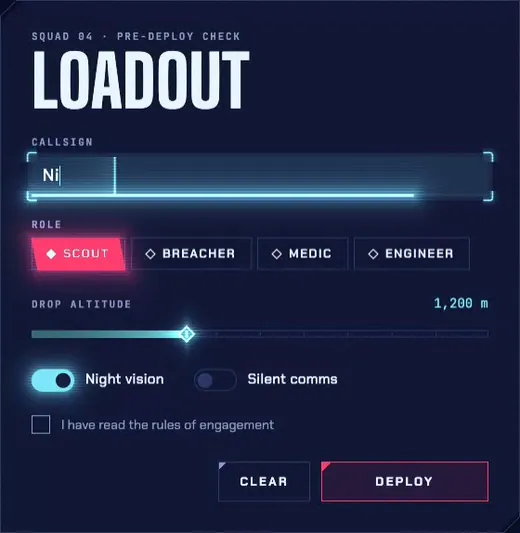
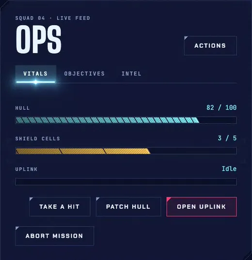
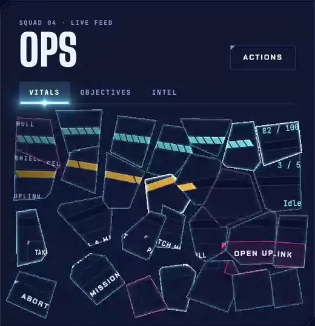
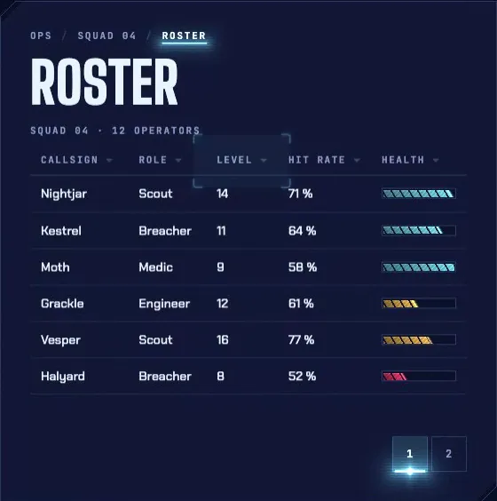
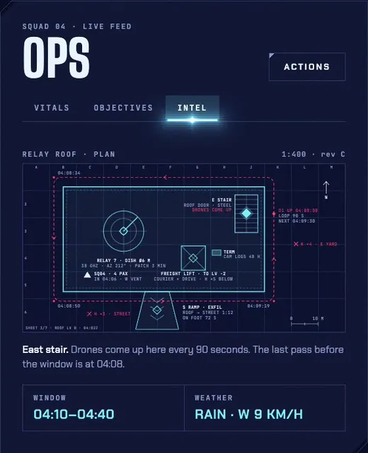

<div align="center">



# DomLoom

**Game-feel UI for plain HTML, drawn by WebGPU.**

Presses dent the button. Panels shatter. Tabs cut like a blade. A scope reads a map.<br>
Underneath, it is still a real, accessible `<form>`.

[](https://github.com/GiuseppeScottoLavina/dom-loom/actions/workflows/ci.yml)
[](https://github.com/GiuseppeScottoLavina/dom-loom/blob/main/LICENSE)
[](#how-it-works)
[](https://github.com/WICG/html-in-canvas)

**[Live demo](https://giuseppescottolavina.github.io/dom-loom/)** · **[Guide](https://giuseppescottolavina.github.io/dom-loom/guide/)** · [Quick start](#quick-start) · [Elements](#what-each-element-does) · [Transitions](#transitions) · [Browsers](#browser-support) · [FAQ](#faq) · [How it works](#how-it-works)

</div>

DomLoom is a library of web components that draws ordinary HTML controls through one WebGPU compositor, with the motion and light of a game interface. A press dents the button under the finger, a radio selection slides to the new choice, a reticle locks onto what you point at or tab to, a hold-to-confirm button charges and fires, an invalid field glitches, and a page changes with a blade that cuts across it. The elements underneath stay real HTML: focusable, read by screen readers, validated and submitted with their form.

It is built on [HTML-in-Canvas](https://github.com/WICG/html-in-canvas) and on the effects host of [`@giuseppe-scotto-lavina/html-in-canvas-polyfill`](https://github.com/GiuseppeScottoLavina/html-in-canvas-polyfill). It runs on Chrome's own implementation (Chrome 157 and later) and, through the polyfill, in the browsers the polyfill supports that have WebGPU; anywhere else the same markup works as plain HTML. See [Browser support](#browser-support).

## Why DomLoom

- **For interfaces that should feel like a game:** web games and their menus, launch and event sites, dashboards meant to impress, portfolios, tools for players. Every interaction answers with motion, light and sound.
- **What CSS cannot do.** CSS moves, scales and clips whole boxes. DomLoom works per pixel on a picture of the live page: a shock front bends the lines of text it crosses, the old page breaks into blocks ahead of a blade, a removed panel shatters into shards that carry its own pixels, a magnifying glass really magnifies, and the new page stays clickable while the old one is still on screen.
- **Still HTML.** You write `<form>`, `<button>`, `<meter>`, `<details>`, ARIA tabs. No new component API to learn: DomLoom recognises the standard elements inside a `<loom-stage>`. Accessibility, form validation, autofill and frameworks keep working, and without WebGPU the same markup falls back to plain CSS.
- **Light at rest.** One canvas per stage, a shader built from the effects the page imports, and no frame rendered while nothing moves. Every component together: about 62 KB of JavaScript, minified and gzipped.

## See it

<table>
<tr>
<td width="50%"></td>
<td width="50%"></td>
</tr>
<tr>
<td><b>Damage you can read.</b> <code>&lt;meter&gt;</code> and <code>&lt;progress&gt;</code> become game bars: a hit cuts the bar, shakes the panel and leaves a trail. ARIA tabs cut with a blade.</td>
<td><b>Irreversible, and it shows.</b> <code>exit: 'shatter'</code> breaks what an update removes into shards made of its own pixels.</td>
</tr>
<tr>
<td></td>
<td></td>
</tr>
<tr>
<td><b>Sort it, watch it move.</b> <code>&lt;table sortable&gt;</code>: the rows fly to their new places, and a click on a flying row reaches it.</td>
<td><b>Read what is too small.</b> <code>[loupe]</code> magnifies the live picture; a click inside the glass lands on what it shows.</td>
</tr>
</table>

## Quick start

```sh
npm install dom-loom
```

For AI agents building a screen, the [DomLoom skill](https://github.com/GiuseppeScottoLavina/dom-loom/blob/main/skills/domloom/SKILL.md) includes a runnable form, component markup, framework recipes and browser checks.

Import the stylesheet and the library once, in your app's entry module (with a bundler such as Vite), and serve the page from `localhost` or HTTPS, which WebGPU needs:

```js
import 'dom-loom/style.css';
import 'dom-loom';
```

Then put the controls that belong together in a stage:

```html
<loom-stage sound>
  <form>
    <label>Callsign <input name="callsign" required></label>
    <label><input type="radio" name="role" value="scout" checked> Scout</label>
    <label><input type="radio" name="role" value="medic"> Medic</label>
    <label>Altitude <input type="range" name="altitude" min="300" max="3000"></label>
    <label><input type="checkbox" role="switch" name="nv"> Night vision</label>
    <button hold="900ms">Deploy</button>
  </form>
</loom-stage>
```

There is nothing else to learn for the controls themselves: DomLoom recognises the standard elements inside a stage. **[The guide](https://giuseppescottolavina.github.io/dom-loom/guide/)** shows every feature with a live example and its code.

### Only what you use

`import 'dom-loom'` brings every component. To pay only for some, import the core and the components you use; each brings its behaviour, its drawing in the default skin and the compositor primitives it needs, and the shader is built from those primitives only.

```js
import 'dom-loom/core';     // <loom-stage>, transitions, buttons and hold, the focus reticle
import 'dom-loom/forms';    // choices, ranges, text fields, numbers
import 'dom-loom/table';
import 'dom-loom/tabs';
```

```css
@import 'dom-loom/base.css';
@import 'dom-loom/skins/holo/base.css';      /* standard HTML */
@import 'dom-loom/skins/holo/toast.css';     /* and the attribute components you use */
@import 'dom-loom/skins/holo/removable.css'; /* (a toast's dismiss button) */
```

| Entry (JavaScript, minified, gzip) | |
| --- | --- |
| `dom-loom/core` | 26 KB |
| `dom-loom/core` + `dom-loom/tabs` | 28 KB |
| `dom-loom/forms` | 31 KB |
| `dom-loom` (all) | 62 KB |

Measured with esbuild (`--bundle --minify`) and `gzip -9`, without the polyfill, which the first stage loads in its own chunk.

The stylesheets of the components that are not standard HTML: `toast.css` (with `removable.css`, which draws the dismiss button), `removable.css`, `badge.css`, `busy.css`, `rating.css`, `dropzone.css`, `combobox.css` (also used by `select`), `carousel.css`, `split.css`, `tilt.css`, `loupe.css`, `lit.css`, `fluid.css`, `overlay.css` (`dialog`, `popover`) and `menu.css` (with `overlay.css`). `base.css` covers the standard elements.

### What each element does

Components: `choice`, `range`, `field`, `number`, `forms` (the four), `dialog`, `popover`, `menu`, `select`, `gauge`, `tabs`, `details`, `table`, `current`, `rating`, `dropzone`, `removable`, `combobox`, `toast`, `alert`, `badge`, `busy`, `tilt`, `carousel`, `split`, `loupe`, `lit`, `fluid`. Cuts and exits: `curl`, `melt`, `shatter` (see Transitions). A component imported later (a lazy chunk) joins the stages already running. The polyfill and the effects host are loaded by the first stage that starts, in their own chunks.

| You write | What happens |
| --- | --- |
| `<button>`, `<summary>`, a link, a label of a radio or checkbox | Pressing dents it around the contact point; releasing sends a ring through it. A button with class `loom-plain` keeps the page's look (the skin does not style it) and still dents |
| `<button hold="900ms">` | The button only fires after a hold (pointer, or Space / Enter on it). It charges, shakes, and bursts when it fires; a tap is refused with a shake. An activation that nobody pressed (a screen reader's, Enter in a field) arms it instead, says "activate again to confirm", and a second one within 4 seconds confirms, so the button works for assistive technology that can only send a click. Screen readers hear "Press and hold, or activate twice, to confirm", in the page's language (see [Languages](#languages)) |
| Radios with the same name | The selection is a slanted fill that slides to the new choice, front edge first |
| `<input type="checkbox" role="switch">` | A knob that stretches as it travels; the track lights up |
| `<input type="checkbox">` | The box fills from the centre |
| `<input type="range">` | A liquid fill that sloshes with the thumb's speed, and a diamond thumb that brightens while dragged |
| Text fields, `<textarea>`, `<select>` | A scan line on focus, an underline that pulses while typing, a glitch when the field is invalid |
| Anything focusable | Lock-on brackets that fly to the hovered or keyboard-focused control. The last input wins: Tab takes the reticle from the mouse. The reticle stays inside the stage, pulled in where a control touches its edge. In a `current="line"` navigation it follows keyboard focus only: there the line and the page's hover style mark the pointer |
| `<meter>`, `<progress>` | A game bar. A drop cuts the bar at once, sends a shock through the whole stage and leaves a white trail that drains after a beat; a gain shows where the bar is going and fills toward it. A `<progress>` without a value sweeps; reaching the end flashes. Meters are cut into chips (`segments="5"` sets how many, `segments="0"` none) and take the colour of their region: `low`, `high` and `optimum` as HTML defines them |
| `<details>` | Opening slides what is below down and uncovers the body behind a scan line; closing shuts it upward and its last rows crumble. Clicks during the slide reach what is shown. Exclusive accordions (`name`) switch with a cut |
| `[role=tablist]` with `[role=tab][aria-controls]` and `[role=tabpanel]` | Tabs that work: click, arrow keys, Home and End select; panels are shown with `hidden`. The indicator stretches to the new tab, and the panel changes with a cut that runs the way you moved. Use `<button type="button" role="tab">` |
| Radio selection, tab indicator | While they move they are glass: the labels they slide over bend at their edges |
| `<table sortable>` | Every header of the first `<thead>` row becomes a sort button (`nosort` on a `<th>` opts out). Rows sort by `data-value` or their text, numbers as numbers, and fly to their new places on arcs; rows that leave the visible set crumble. `loom-sort` fires first (cancelable, to sort on a server), `loom-sorted` once the rows are in order |
| `<input type="number">` | Stepping rolls the digits over: the old value leaves, the new one comes in. Arrow keys and the wheel step it; so does a `<button aria-controls="its-id" data-step="1">` (or `-1`). With `step="any"`, `data-step` is an amount in the field's units and `data-step-by` on the field sets what an arrow key or a wheel notch adds (1 by default); the value lands on that amount's grid (105 + 10 is 110), within `min` and `max` |
| `[interval]` holding two `<input type="range">` | One track with two thumbs that cannot cross; the liquid runs between them |
| `<input list>` with its `<datalist>` | The browser's popup cannot be drawn into a canvas, so the stage opens its own listbox under the field (the ARIA combobox pattern: arrow keys, Enter, Escape). It unfolds and folds with a scan line |
| `[removable]` (a tag, a chip, a list item) | Gets a remove button (also Delete or Backspace on it). Removing crumbles it and the rest flies into the gap; `loom-remove` fires first (cancelable). A removable element that is added assembles block by block. `removable="row"` does the same for an element that is not a chip (a table row, a grid row): it keeps its own look, and only the remove button is styled. A remove button the page supplies (`button.loom-remove` inside the element) keeps its label and its content |
| `[removable][exit="shatter"]` (`dom-loom/shatter`) | The removed element breaks into Voronoi shards that fly off instead of crumbling; the rest still flies into the gap |
| `[dropzone]` holding an `<input type="file">` | Files dragged over it pull the panel into a vortex at the pointer; dropped, they go to the input (its `change` fires) and the vortex collapses |
| `[rating]` around a radio group | Stars: pointing previews, choosing lights them up one after another |
| `[toasts]` (a list or a box) | Each child is a toast: it assembles, counts down (`data-timeout`, 5 s by default) with a bar of light, holds while pointed at or focused, and crumbles when the time is up or it is dismissed. `data-tone` is `good`, `warn` or `bad`. The region is made a polite live region. `toasts="viewport"` is for a page's notifications: in a `<loom-stage bare>` of its own, the list sits at the bottom centre of the viewport, above the page, across the width of a phone |
| `role="alert"` | When an alert appears or its text changes, it lands with a shock and its text tears for a moment |
| `[badge]` | When its number changes, it pings (up and down sound and light differently) |
| `aria-busy="true"` | The placeholder content is drawn as blocks and a scan passes over it while busy; when it is no longer busy the real content assembles block by block |
| `<progress ring>`, `<meter ring>` | A ring instead of a bar, with the same damage trail, gain preview, segments and sweep |
| `[tilt]` (a card) | Turns toward the pointer in perspective, with a shadow and a glare; in holo its foil lights up the edges of the content as it turns. Its content stays clickable where it is drawn |
| `[carousel]` (a scroll container) | Scroll-snapping strip that the mouse can drag; buttons with `aria-controls` and `data-step` move it a slide. While it moves it curves like film, the more the faster |
| `[split]` holding a pane, an `<hr>` and a pane | The `<hr>` is a window splitter: drag it, or focus it and use the arrow keys, Home and End (`aria-valuemin`, `aria-valuemax`, `aria-valuenow` in %). Pulled past a limit, the panes stretch like rubber and spring back |
| `[loupe]` (a table, a block of small text; `dom-loom/loupe`) | A magnifying glass follows the mouse over the element: `loupe="3"` sets the magnification (default 2), `loupe-size="160"` its diameter. The glass really magnifies the picture, and a click inside it lands on the magnified element. On touch, press and hold shows the glass above the finger; a plain tap is left alone |
| `[lit]` (a bordered panel; `dom-loom/lit`) | The pointer is a point light: text and borders emboss under it. `lit="0.6"` sets the intensity |
| `[fluid]` (a readout panel; `dom-loom/fluid`) | Dragging the pointer across it stirs the content like water, and it settles. `fluid="0.5"` sets the strength. The holo skin sets `touch-action: pan-y pinch-zoom` on it, so a finger stirs sideways and still scrolls and zooms the page; give the element the same in a custom skin |
| `<dialog>` or `[popover]` holding `<loom-stage overlay>` | The stage is transparent around its panel (cut corners are cut out) and opens from a line of light; `overlay="left"`, `"right"`, `"top"` or `"bottom"` opens it from that edge (a drawer). A dialog closed by Escape, a `<form method="dialog">` or a `command="close"` button shuts first, then closes, with its `returnValue`. `dialog.close()` from a script closes at once, and so does a popover dismissed by a click outside |
| `[role=menu]` in a popover's overlay stage | The ARIA menu pattern: the first item takes the focus; arrows, Home, End and a letter move it (a light follows); `menuitemcheckbox` and `menuitemradio` toggle; choosing closes the menu; Escape and Tab close it; the focus returns to the button. A popover opened by a `popovertarget` button is anchored under it (above if there is no room) and opens from that side |
| `<select>` | A pointer opens its list inside the stage (the browser's popup cannot be drawn into a canvas). The keyboard and screen readers keep the select's own behaviour and popup |
| `aria-current` in a list | The current page of a `<nav>` list, the place in a `nav[aria-label=breadcrumb]`, or the step of an `<ol>` with `aria-current="step"`: the marker stretches over when it moves, and a stepper's beam runs up to the current step. `current="line"` on a page's own navigation (on the `nav` or its list) keeps the links' look and marks the current one with a line on its bottom edge, which slides to the next. The reticle shows there on keyboard focus only |

### Transitions

```js
const stage = document.querySelector('loom-stage');
await stage.transition(() => showReceipt());
```

It works like `document.startViewTransition(update)`. The compositor keeps a picture of the old content, runs `update`, then cuts to the new content with a slanted blade; ahead of the blade the old page breaks into blocks that are blown away. Elements with the same `view-transition-name` (or `data-morph`) in both states fly on an arc from the old place to the new one, leave a streak, and reassemble line by line. Unlike a native view transition, the new page is live while this plays: a click on a flying element reaches that element, and the old page takes no input.

`stage.transition(update, { scope: element, direction: -1 })` cuts only the region of `scope` (an element or a list of them, measured before and after the update), right to left.

`stage.transition(update, { morph: elements, cut: false })` has no blade: the listed elements fly from where they were to where they are after `update` (a reorder, a move to another column), and those that are no longer shown crumble where they were.

`stage.transition(update, { style: 'curl' })` (`dom-loom/curl`) swaps the blade for a page turn: the old page peels away from one side, over the new one, which is live underneath. `scope` and `direction` work as for the blade (`direction: -1` peels from the right). `{ style: 'melt' }` (`dom-loom/melt`) drips the old page down and reveals the new one from the top. Without the entry the style is not registered and the blade is used.

`stage.transition(update, { morph: elements, exit: 'shatter' })` (`dom-loom/shatter`) breaks the elements that `update` removes into shards instead of crumbling them.

### Attributes and API

| | |
| --- | --- |
| `sound` | Procedural interface sounds (WebAudio, no files), after the first gesture in the stage |
| `haptics` | Short vibrations where the device has them: toggles, tabs, ratings, a completed hold, a hit or a gain on a bar, an alert, a file drop |
| `static` | Never start the compositor; plain DOM styling only |
| `bare` | No panel: no background, padding or frame, and the canvas is transparent, so the page shows through. For a stage around a layout element (a nav in a header) or a page's toasts |
| `fill` | The stage's parent sets its height (a stretched flex or grid item, a fixed height) and its content takes all of it: one child (a nav, a toolbar) fills the box. Not for a stage that should shrink with its content |
| `loading="lazy"` | Keeps the HTML interactive and starts the GPU within 240 CSS pixels of the viewport once scrolling settles. Focus, a pointer press or switching to `eager` starts it immediately. The default is eager. |
| `stage.ready` | Resolves with `'webgpu'` or `'dom'`. Reading it explicitly starts a lazy stage, as does supplying React's `onReady`. |
| `stage.transition(update, {scope, direction, morph, cut, style, exit})` | See above; `style` is `'curl'` or `'melt'` (a cut drawn in place of the blade), `exit` is `'shatter'`. Resolves when the transition has ended |
| `skin` | The skin that draws the stage (default `holo`) |
| `stage.discard(el, update?, {exit})` | Removes an element with motion: it crumbles (`exit: 'shatter'` breaks it into shards), and what follows it flies into the space it leaves. A framework passes `update`, which removes it from its state |
| `stage.reveal(el)` | Has an element that was just added assemble block by block |
| `stage.mapPoint({x, y})` | The point of the live content shown at a visible point of the stage (CSS px), `null` where no element is shown |
| `data-renderer`, `data-mode` | `webgpu` / `loading` / `dom`; and, while the compositor runs, `native` (Chrome's own HTML-in-Canvas), `native-bridged` (an earlier native draft that the polyfill completes) or `polyfill` |
| `loom-fallback` event | The compositor failed and the stage went back to plain DOM; `detail.error` says why |

### Languages

DomLoom names the controls it adds and announces holds for screen readers: "Remove Garlic", "Dismiss", "Sort by Level", "Resize panes", "Press and hold, or activate twice, to confirm". Each name is in the language of its element (its nearest `lang`, else the page's). English and Italian are built in; `defineStrings` adds a language or changes some of its words, and the words a language leaves out are English. A label or description the page sets itself always wins.

```js
import { defineStrings } from 'dom-loom';

defineStrings('de', {
  remove: (label) => `${label} entfernen`,
  dismiss: 'Schließen',
  sortBy: (label) => `Nach ${label} sortieren`,
  resizePanes: 'Bereiche anpassen',
  holdHint: 'Gedrückt halten oder zweimal aktivieren, um zu bestätigen',
  holdArmed: (label) => `${label}: zum Bestätigen erneut aktivieren`,
});
```

## Browser support

| Path | Where | What you get |
| --- | --- | --- |
| Native HTML-in-Canvas + WebGPU | Chrome 157 and later | Every effect. The polyfill's core is not downloaded. |
| Polyfill + WebGPU | Where the polyfill runs and the browser has WebGPU: Chrome 130 to 156, Safari 27+ on macOS, Safari on iPadOS 26+, Firefox 155+, Chrome for Android 130+ | Every effect, through the polyfill's snapshots. DomLoom is tested on desktop Chrome (native and polyfill paths) and on an iPad with Safari; Safari on macOS, Firefox, Edge and Android are not tested with DomLoom yet. |
| No WebGPU, a GPU failure, forced colours | Any browser | The same HTML, styled in plain CSS. Holds, validation, tabs, sorting and transitions (as an instant swap) still work. |

With `prefers-reduced-motion`, springs snap, transitions swap at once and nothing shakes.

## FAQ

**Why not CSS animations, or the View Transitions API?**
They animate boxes: move, scale, fade, clip. DomLoom's effects work on the pixels of the live page (bending text under a shock, shattering a panel into shards of itself, refracting labels under moving glass, magnifying), and they stay interactive while they play: the input mapper sends a click to the element drawn under the pointer, even mid-flight. A view transition shows a screenshot that takes no input until it ends.

**Is it accessible?**
The controls are the browser's own elements, so focus, keyboard, screen readers, form validation and autofill are unchanged. A hold-to-confirm button also confirms with a double activation, for assistive technology that can only send a click. Reduced motion and forced colours are honoured. The browser suite compares the accessibility tree with and without the GPU.

**What does it cost?**
About 62 KB of JavaScript (minified, gzip) for every component, 26 KB for the core; import only the components you use and the shader is built from their primitives alone. One canvas per stage, one GPU device for the page, and no frame at rest. On Chrome 157+ the whole demo loads about 95 KB of JavaScript, gzipped.

**Does it work with React, Vue, Svelte?**
Yes: `<loom-stage>` is a custom element. React and Vue have small helpers (`dom-loom/react`, `dom-loom/vue`) that flush your state updates inside a transition. See [Frameworks](#frameworks).

**Can it look different?**
The look is a skin: draw hooks that turn each control's state into compositor primitives, plus a stylesheet for the controls at rest. `holo` is the default; you can theme it with CSS custom properties or [write your own](#skins).

**I build with an AI agent.**
Point it at [the DomLoom skill](https://github.com/GiuseppeScottoLavina/dom-loom/blob/main/skills/domloom/SKILL.md): a runnable form, component markup, framework recipes and the checks to run in a browser.

## Frameworks

`<loom-stage>` is a custom element and works in any framework. Two things need care. A transition keeps a picture of the page before your update, so the update must be in the DOM when it returns. And DomLoom changes the DOM of a sorted table or a removed chip only when nobody else owns it: in a framework, cancel `loom-sort` and `loom-remove` and change your state instead, inside a transition or a discard.

**React** (`dom-loom/react`). React owns the rows here, so the component cancels DomLoom's own sort and sorts its state inside a transition:

```jsx
import { useRef, useState } from 'react';
import { LoomStage, useLoomEvent, useLoomTransition } from 'dom-loom/react';
import 'dom-loom/style.css';
import 'dom-loom/table';

const PLAYERS = [['Ivy', 12], ['Bram', 31], ['Osei', 7]];

export function Roster() {
  const stage = useRef(null);
  const [players, setPlayers] = useState(PLAYERS);
  const [sort, setSort] = useState(null);
  const transition = useLoomTransition(stage); // flushes your update inside the cut

  useLoomEvent(stage, 'loom-sort', (event) => {
    event.preventDefault();
    const { column, direction } = event.detail;
    const sign = direction === 'ascending' ? 1 : -1;
    const rows = [...stage.current.querySelectorAll('tbody tr')]; // before the update
    transition(() => {
      setSort({ column, direction });
      setPlayers((list) => [...list].sort((a, b) => (a[column] > b[column] ? sign : a[column] < b[column] ? -sign : 0)));
    }, { morph: rows, cut: false });
  });

  return (
    <LoomStage ref={stage} sound>
      <table sortable="">
        <thead>
          <tr>
            <th aria-sort={sort?.column === 0 ? sort.direction : undefined}>Player</th>
            <th aria-sort={sort?.column === 1 ? sort.direction : undefined}>Level</th>
          </tr>
        </thead>
        <tbody>
          {players.map(([name, level]) => <tr key={name}><td>{name}</td><td>{level}</td></tr>)}
        </tbody>
      </table>
    </LoomStage>
  );
}
```

`useLoomDiscard(stage)` does the same for a removal: cancel `loom-remove`, then `discard(element, () => setItems(…))`. Write DomLoom's attributes as strings in JSX (`sortable=""`, `hold="900ms"`); the types in `dom-loom/react` declare them.

**Vue** (`dom-loom/vue`). Tell Vue that `<loom-stage>` is a custom element, in the app (runtime templates) or in the compiler (single-file components), and use the composable in a component:

```js
// main.js
import { createApp } from 'vue';
import { DomLoom } from 'dom-loom/vue';
createApp(App).use(DomLoom).mount('#app');

// vite.config.js
import vue from '@vitejs/plugin-vue';
import { isCustomElement } from 'dom-loom/vue';
export default { plugins: [vue({ template: { compilerOptions: { isCustomElement } } })] };

// a component's <script setup>, with <loom-stage ref="stage"> in its template
import { ref } from 'vue';
import { useLoomStage } from 'dom-loom/vue';
const stage = ref(null);
const { transition, discard } = useLoomStage(stage); // waits for nextTick inside the cut
```

Svelte, Solid, Angular (with `CUSTOM_ELEMENTS_SCHEMA`) and plain HTML use the element directly. TypeScript types ship with the package.

## Skins

A skin's rules have no specificity (they are written with `:where()`), so any rule of the page wins over them without `!important`, and a button with class `loom-plain` keeps the page's look altogether. A skin decides how a stage looks, moves and sounds. The behaviours (pressing, holding, selecting, sorting, validating) are the same for every skin: they compute what a control is doing and hand that state to the skin's draw hooks, which turn it into compositor primitives. `holo`, the holo-kinetic material above, is the default skin.

```js
import { defineSkin, PILL, RING, ADD } from 'dom-loom';

defineSkin({
  name: 'mine',
  tokens: { accent: ['--mine-accent', '#ffcc00'], bg: ['--mine-panel', '#ffffff'] },
  roles: { hot: 'accent', rim: 'accent', bg: 'bg', void: 'bg' },
  shader: { scanlines: 0, chroma: 0.3, crumble: 0, hatch: 0 },
  draw: {
    press(scene, { rect, depth }, { colors }) {
      scene.push(PILL, rect, [4, 0, 8, depth * 0.3], colors.accent, ADD);
    },
  },
  sounds: { press: () => {} },
});
```

```html
<loom-stage skin="mine">…</loom-stage>
```

Draw hooks receive `(scene, state, ctx)`; `ctx` holds `colors` (from `tokens`), `now`, `reduced`, `whole` (the stage's rect), `durations` and `stage`. A hook a skin leaves out draws nothing. The hooks and their state:

| Hook | State |
| --- | --- |
| `reticle` | `rect`, `alpha`, `flash` |
| `press` | `rect`, `point`, `depth`, `released`, `t` (ms since release), `strength` |
| `charge`, `burst`, `nudge` | `rect`, and `progress` and `holding`, or `t` |
| `choice` (radio group) | `rect`, `alpha`, `motion` (the rect's springs, for speed) |
| `indicator` (tabs) | `rect`, `alpha`, `motion`, `list` (the tablist) |
| `switch`, `checkbox`, `toggled` | `rect`, and `position`, `velocity`, `on`, or `amount`, or `t`, `on`, `select` |
| `range` | `rect`, `value`, `drag`, `slosh` |
| `field` | `rect`, `scan`, `focus`, `typing`, `invalid`, `glitch` |
| `gauge` | `rect`, `kind`, `fill`, `trail`, `gaining`, `tone` (0 good, 1 caution, 2 bad), `segments`, `indeterminate`, `hit`, `complete` |
| `current` | `rect`, `alpha`, `motion`, `value` (the `aria-current` value), `items`, `index`, `list` |
| `sorted` | `rect`, `t`, `direction` |
| `reveal` (details) | `column`, `line`, `shown`, `k`, `opening` |
| `rolled` (number), `unfold` (listbox) | `rect`, and `t`, `direction`, or `line`, `k`, `opening` |
| `rating` | `stars` (rects), `value`, `hover`, `lit` (ms since each star lit) |
| `drop` | `rect`, `point`, `pull` (0..1 while files hover), `dropped` (ms since the drop), `files` |
| `interval` | `rect`, `low`, `high`, `drag` (two values), `slosh` |
| `option` (listbox), `menuitem` (menu) | `rect`, `alpha`, `motion` |
| `aperture` (overlay) | `rect`, `open` (0..1), `from` (0 a line of light in the middle, 1 left, 2 right, 3 top, 4 bottom), `closing` |
| `toast` | `rect`, `left` (time left, 0..1), `paused`, `tone` |
| `alert`, `badge` | `rect`, `t`, and `tone` or `up` |
| `busy` | `rect`, `now` |
| `tilt` | `rect`, `rotX`, `rotY` (radians), `lift`, `glare` (the pointer) |
| `bend` (carousel) | `rect`, `speed` (px per ms) |
| `split` | `rect`, `laid` (the divider in the layout), `shown` (where it is drawn), `dragging`, `focused` |
| `loupe` | `rect`, `center`, `focus`, `radius`, `mag`, `open`, `phase` |
| `lit` | `rect`, `point`, `reach`, `power`, `open` |
| `fluid` | `rect`, `strength` |
| `gauge` with `ring` | as `gauge`, with `ring: true` |

Every state also has `el`, the element. A skin's stylesheet styles the controls at rest; scope its rules to `loom-stage[skin="mine"]`, and load it next to `dom-loom/base.css`, which holds what every skin relies on. `dom-loom/style.css` is base plus holo.

A token's fallback can be a function of the stage that returns a CSS colour, to read the page around it (its background, its accent). `draws` lists the native parts a skin's hooks paint instead, which `base.css` hides on the GPU path: `'focus'` (the outline), `'thumbs'` (a range's thumb and fill), `'gauges'` (the values of meter and progress); the default is all three. `reticle: { hover: false }` keeps the reticle on keyboard focus. A stage whose page paints no panel shows its `bg` colour where the page is transparent.

The holo material is themed with custom properties on the stage: `--loom-void`, `--loom-panel`, `--loom-line`, `--loom-ink`, `--loom-dim`, `--loom-holo`, `--loom-signal`, `--loom-warn`, `--loom-cut`, `--loom-font`, `--loom-display`, `--loom-mono`.

The blends of the paint primitives: `ADD` (light), `BEHIND` (only the dark parts of the picture), `OVER`, `INK` (multiplies: ink on paper, black stays black) and `INVERT` (reverses the picture). `PILL` takes all five, `TONE` takes `BEHIND`, `OVER`, `INK` and `INVERT`, `FOCUS` takes `OVER` and `INK`. `TONE` is a screentone cut to a box (period, cover, angle, gradation) and `FOCUS` draws focus lines that converge on a clear oval; both come and go by their amount, growing and shrinking rather than fading.

## How it works

- **One stage, one canvas, one pass.** `<loom-stage>` moves its content into a `<canvas content="drawable">` and creates one effects host with one compositor plugin. Each control's behaviour describes its state every frame as a few items in a buffer: spatial items (dent, jitter, glitch, morph) move the picture, and light items (brackets, fills, rings, scan lines, liquid) are SDF shapes painted over it. There is no canvas per component.
- **The DOM holds still.** Hover, press, drag and focus never change CSS. They change shader uniforms, so they show in the next frame and cost no re-capture of the HTML. The DOM changes only when the control's state does (`checked`, `value`), and the GPU animates the change. `loom.css` contains no transition on the GPU path.
- **The shader is built from what the page uses.** Each primitive (`src/primitives/*`: a dent, a lens, a tilted card, an arc…) is one module with its WGSL and the JavaScript twin of what it does to the picture. The compositor compiles the primitives the page has imported, and every frame tells the shader which kinds are in the scene, so a pass for an effect that is not on screen costs nothing.
- **The input mapper is the shader.** A fragment shader maps backwards, from the pixel shown to the source point it shows, and that is exactly the question the host's input mapper answers for a pointer. Each primitive's JavaScript twin sits next to its WGSL. Each presented frame freezes its own numbers for the mapper, and the browser test checks the twins against real GPU pixels.
- **Why it needs the GPU.** CSS can move, scale and clip whole boxes. It cannot bend the lines of text a shock front crosses, refract a label under a moving piece of glass, break a picture of the old page into blocks, smear a flying element along its path, or keep the new page clickable while the old one is still on screen. Those are per-pixel operations on a picture of live HTML, which is what HTML-in-Canvas provides; the mapper keeps every one of them clickable where it is seen.
- **Zero work at rest.** The plugin is `continuous` only while a spring moves. A page at rest renders no frame.
- **Starting.** Until the compositor is compiled, a stage's content is the page's: shown and clickable as plain HTML. It moves into the canvas only when the first frame can follow at once, never under a press in progress, and until that frame a click goes to what is under it. The boot sweep is only seen: it takes no input.
- **Fallbacks.** Without WebGPU, in forced colours, or after a GPU failure, the same markup is styled in plain CSS and the behaviours (hold, validation, transitions as an instant swap) keep working. With reduced motion, springs snap, transitions swap at once and nothing shakes.

## Limits

- A stage on the page is an opaque rectangle: its cut corners are painted in `--loom-void`, so put stages on a background of that colour. Overlay stages are transparent.
- All stages of a page share one GPU device. Still, use a few stages per page (one per panel), not one per control: each has its own canvas and capture.
- Top-layer content (an open modal `<dialog>`, an open popover) is not drawn into the canvas of the page's stages: give it its own `<loom-stage overlay>` (dom-loom/dialog, dom-loom/popover).
- Date and colour pickers open with the browser's own look; so does a select's popup when opened from the keyboard or a screen reader (on purpose: it is fully accessible).
- Opening or closing a `<details>` changes the height of the stage at once (the canvas must have the size of its content); the content inside slides. In a multi-column layout only the column of the `<details>` slides.
- On a software GPU (SwiftShader, as in headless test runs) the first draw of a stage compiles its shader on the CPU, and the page can get no new frame for seconds to minutes. Clicks still land meanwhile. Browsers do not enable WebGPU on SwiftShader by default.
- A press in the first moments of a flight (rows sorting) can reach nothing on Chrome's own HTML-in-Canvas: the press is mapped with the frame the browser captured for it, which may still show the row leaving. It never reaches another row.

On Chrome's own HTML-in-Canvas the polyfill's core is not downloaded: the page loads DomLoom, the polyfill's loader and its effects host (about 270 KB of JavaScript for the whole demo, 95 KB gzip, measured on a production build).

## Develop

Node 22.12 or later.

```sh
npm install
npm run dev              # the demo at http://127.0.0.1:5173
npm test                 # unit tests: the mapper twins, the shader, the stage's scheduling
npm run test:browser     # Chrome with WebGPU, native path and polyfill path
npm run test:app         # what an app's page needs: languages, plain buttons, rows, a page's toasts, a bare stage
npm run test:startup     # no click lost while stages start, on a hardware and a software GPU
npm run test:effects     # the loupe, lit, fluid, shatter, melt and curl suites
npm run test:guide       # every example of the guide, on both paths
npm run test:types       # the public TypeScript types
npm run build            # the demo and the guide in dist/
```

`npm run test:browser` uses `/Applications/Google Chrome.app` or `CHROME_PATH`. It checks that no frame renders at rest, compares pressed GPU pixels with the input mapper, and checks the hold guard, form validation, a click on an element in flight, the damage trail of a meter, the scoped cut of the tabs, a click on a sliding summary, sorting, the mapping of a press on a row in flight, pagination and steppers, the DOM fallback and reduced motion.

`npm run test:effects` runs each `test/effects-*.browser.mjs` suite in its own process, on the native path and the polyfill path. It checks that the glass really magnifies and a click inside it reaches the magnified button, that a lit surface moves no pixel, that a stirred panel settles by itself and a click lands on the button shown where the water displaced it, that shards leave through the input mapper and the picture alike, that a curling or melting page takes input only where the new page is live, and that every stage rests, with reduced motion and without WebGPU.

### Publish the demo

`.github/workflows/pages.yml` builds the demo and publishes it on GitHub Pages at every push to `main` (it runs the unit tests first). In the repository, set Settings → Pages → Source to "GitHub Actions" once. The build uses relative URLs, so the demo works under `https://<user>.github.io/<repo>/`. The guide's pages are generated from `guide/src/*.html` by `node scripts/guide-page.mjs` (edit the sources, then run it). `node scripts/record-media.mjs` films the README's animations from the demo (Chrome and ffmpeg).

## Contributing

Issues and pull requests are welcome: see [CONTRIBUTING.md](https://github.com/GiuseppeScottoLavina/dom-loom/blob/main/CONTRIBUTING.md). Changes are listed in [CHANGELOG.md](https://github.com/GiuseppeScottoLavina/dom-loom/blob/main/CHANGELOG.md); report security problems as [SECURITY.md](https://github.com/GiuseppeScottoLavina/dom-loom/blob/main/SECURITY.md) says.

## Licence

MIT. See [LICENSE](https://github.com/GiuseppeScottoLavina/dom-loom/blob/main/LICENSE).
